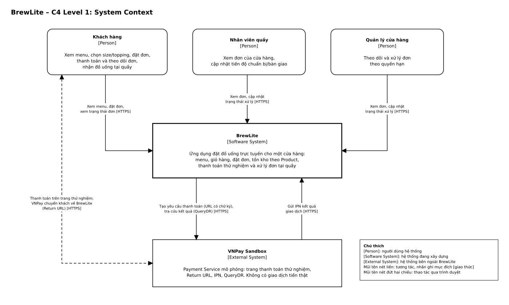
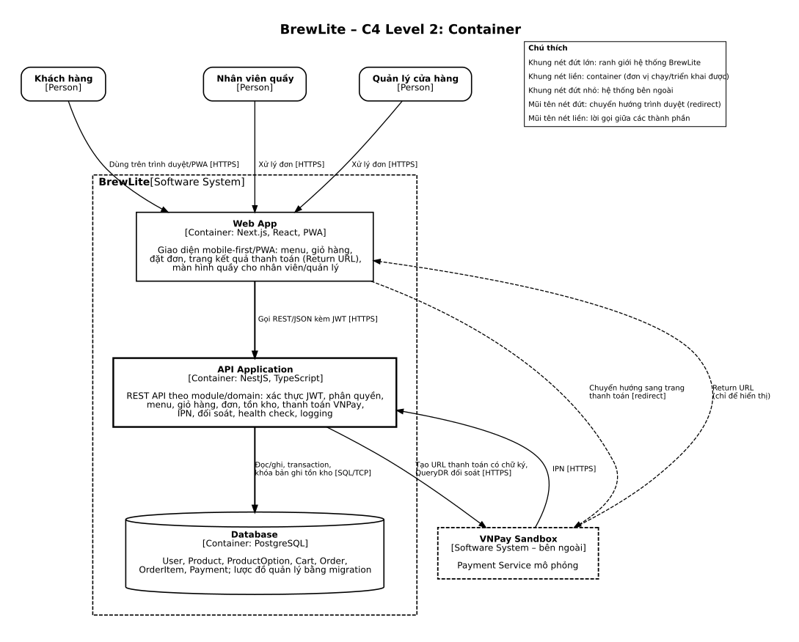
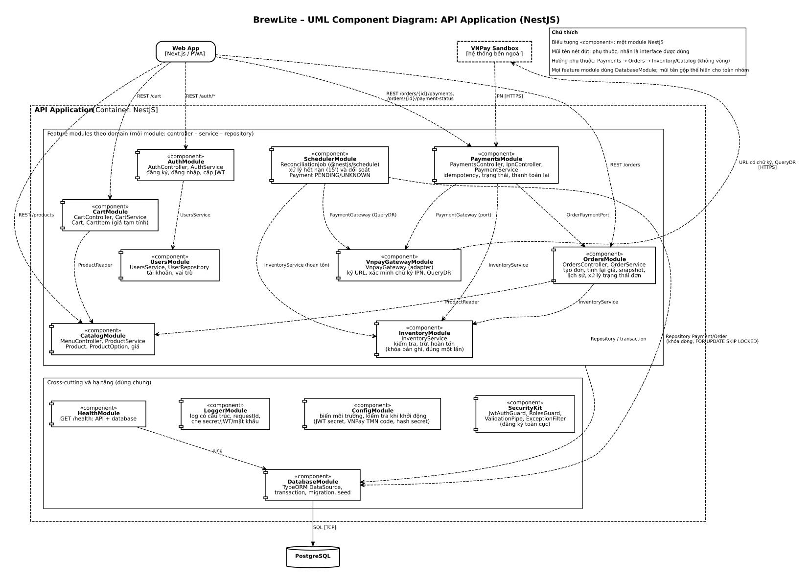

# Task 3.1 – Phương pháp và quyết định kiến trúc BrewLite

Tài liệu trình bày kiến trúc đề xuất của BrewLite theo **C4** (Context, Container) kết hợp **UML Component** cho NestJS API. Nguồn nghiệp vụ: `docs/requirements/context-and-scope.md`, `srs.md`, `use-case-checkout.md`, `docs/diagrams/domain-class.md`, `sequence-checkout.md`. Mỗi quyết định quan trọng có một ADR ngắn trong `docs/architecture/adr/`.

## 1. Phương pháp trình bày

| Mức | Sơ đồ | Trả lời câu hỏi | Tệp |
| :-- | :--- | :--- | :--- |
| C4 – Level 1 | System Context | BrewLite phục vụ ai và nói chuyện với hệ thống bên ngoài nào? | `c4-context` |
| C4 – Level 2 | Container | BrewLite gồm những đơn vị chạy được nào, dùng công nghệ gì, giao tiếp ra sao? | `c4-container` |
| UML Component | Component của API Application | Bên trong NestJS API chia module nào, phụ thuộc nhau thế nào? | `component-api` |

Quy ước ký hiệu (không trộn ký hiệu giữa các loại sơ đồ; không dùng Use Case, Activity, Sequence hay Deployment):

| Sơ đồ | Ký hiệu | Cách nhận biết phần tử |
| :--- | :--- | :--- |
| C4 Context | C4 | Nhãn chữ trong khối: `[Person]`, `[Software System]`, `[External System]`. Mũi tên nét liền, nhãn ghi mục đích và `[giao thức]`. |
| C4 Container | C4 | Nhãn `[Container: công nghệ]`, `[Person]`, `[External System]`; khung nét đứt lớn duy nhất là ranh giới `BrewLite [Software System]`. Hình trụ chỉ dùng cho database. |
| Component (API) | UML | `«component»` (hình chữ nhật có hai tab bên trái), `«package»` (khung có tab), `«subsystem»`; quan hệ là **dependency** (nét đứt, đầu mũi tên mở), nhãn là interface được dùng. Phần tử ngoài API: `«client»`, `«external system»`, `«database»`. |

Tất cả sơ đồ làm kiểu basic đen trắng: nền trắng, nét đen, chữ đen, không icon, không tô màu; loại phần tử phân biệt bằng nhãn chữ. VNPay Sandbox luôn nằm ngoài ranh giới BrewLite.

Nguồn Draw.io (`.drawio`) nằm ở `docs/diagrams/sources/`; bản xuất SVG và PNG nằm ở `docs/diagrams/exports/` và mô tả cùng một nội dung (cùng tọa độ, cùng nhãn). Khi chỉnh sửa sơ đồ trong Draw.io, phải xuất lại SVG/PNG và thay thế file tương ứng.

Kiến trúc chọn là **modular monolith**: một Web App, một API (chia module theo domain), một database; VNPay Sandbox là hệ thống ngoài (ADR-004).

## 2. C4 Level 1 – System Context

- **Người dùng:** Khách hàng (xem menu, đặt đơn, thanh toán, theo dõi đơn), Nhân viên quầy và Quản lý cửa hàng (xem đơn, cập nhật tiến độ). Khớp ACT-01 đến ACT-03 trong SRS.
- **BrewLite:** hệ thống duy nhất đang xây dựng, phục vụ một cửa hàng, nhận đồ tại quầy.
- **VNPay Sandbox:** Payment Service mô phỏng bên ngoài (ACT-04), không xử lý tiền thật. BrewLite gửi yêu cầu thanh toán có chữ ký và truy vấn kết quả (QueryDR); **VNPay gửi IPN trực tiếp vào NestJS API** (không qua Web App). Khách thao tác thanh toán trực tiếp trên trang VNPay sau khi được chuyển hướng; **Return URL chỉ chuyển trình duyệt về Web App để hiển thị** — không phải căn cứ xác nhận thanh toán.

## 3. C4 Level 2 – Container

| Container | Công nghệ | Trách nhiệm | ADR |
| :--- | :--- | :--- | :-: |
| Web App | Next.js, React, PWA | Giao diện mobile-first, trang kết quả thanh toán (Return URL), màn hình quầy. Không chứa nghiệp vụ. | 007 |
| API Application | NestJS, TypeScript | Toàn bộ nghiệp vụ: xác thực/phân quyền, tính giá, tồn kho, thanh toán, IPN, đối soát, health check, logging. | 002, 005, 006, 008–010 |
| Database | PostgreSQL | Lưu User, Product, ProductOption, Cart, **CartItem**, Order, OrderItem, Payment; transaction và khóa dòng; lược đồ do migration quản lý. | 003 |

Luồng giao tiếp chính:
1. Người dùng ↔ Web App qua HTTPS.
2. Web App → API: REST/JSON kèm JWT.
3. API → Database: SQL qua TCP; không có container nào khác truy cập database.
4. API → VNPay Sandbox: URL thanh toán có chữ ký, QueryDR. **VNPay Sandbox → API: IPN** (gọi thẳng vào NestJS API endpoint, không qua Web App).
5. Web App ↔ VNPay Sandbox: chỉ là chuyển hướng trình duyệt (đi) và Return URL (về). **Return URL chỉ để hiển thị** — sau khi trình duyệt về, Web App gọi `GET /orders/{id}/payment-status` vào API để lấy trạng thái đã xác minh.

Triển khai chi tiết (Docker Compose, HTTPS, database không public) thuộc Task 3.2.

## 4. UML Component – API Application (NestJS)

| Component | Trách nhiệm chính | Dùng (interface) | Use case / yêu cầu |
| :--- | :--- | :--- | :--- |
| `AuthModule` | Đăng ký, đăng nhập, cấp JWT | `UsersService` | UC-04, UC-05, UC-06; FR-04, FR-05 |
| `UsersModule` | Tài khoản, vai trò | — | FR-04, FR-06 |
| `CatalogModule` | Menu, chi tiết Product, ProductOption, giá | — | UC-01, UC-02; FR-01, FR-02 |
| `CartModule` | Giỏ hàng, giá tạm tính | `ProductReader` | UC-03; FR-03 |
| `OrdersModule` | Tạo đơn, tính lại giá từ dữ liệu hiện hành, snapshot `OrderItem`, lịch sử đơn, xử lý trạng thái `Order.status` | `ProductReader`, `InventoryModule` (trừ/hoàn `Product.inventoryQuantity`) | UC-07, UC-09 đến UC-12; FR-07, FR-12 đến FR-15 |
| `InventoryModule` | Kiểm tra, trừ, hoàn `Product.inventoryQuantity`; khóa dòng; hoàn đúng một lần. **Không phải entity riêng** — tồn kho chỉ lưu tại `Product.inventoryQuantity` trong `ProductModule`/`CatalogModule` | — | FR-08, FR-11 |
| `PaymentsModule` | Khởi tạo thanh toán, idempotency, IPN, thanh toán lại, đọc `Payment.status` | `OrderPaymentPort`, `InventoryModule` (hoàn `Product.inventoryQuantity`), `PaymentGateway` | UC-08; FR-09, FR-10 |
| `SchedulerModule` | `ReconciliationJob`: xử lý hết hạn (15 phút) và đối soát `Payment` ở trạng thái `PENDING`/`UNKNOWN` | `PaymentGateway`, `InventoryModule` (hoàn `Product.inventoryQuantity`) | FR-11; NFR-09 |
| `VnpayGatewayModule` | Adapter VNPay: ký URL, xác minh chữ ký IPN, QueryDR | VNPay Sandbox (HTTPS) | FR-09; NFR-04 |
| `SecurityKit` | `JwtAuthGuard`, `RolesGuard`, `ValidationPipe`, `ExceptionFilter` (toàn cục) | — | FR-06; NFR-02, NFR-03 |
| `ConfigModule` | Biến môi trường, kiểm tra khi khởi động | — | NFR-04, NFR-07 |
| `LoggerModule` | Log JSON, `requestId`, che secret | — | NFR-02, NFR-04 |
| `HealthModule` | `GET /health` (API + database) | `DatabaseModule` | NFR-07, NFR-09 |
| `DatabaseModule` | TypeORM, transaction, migration, seed | PostgreSQL | NFR-07, NFR-09 |

`SchedulerModule` tách riêng khỏi `PaymentsModule` để thể hiện rõ đây là một tiến trình chạy định kỳ, độc lập với vòng đời của một request HTTP, dù cùng thao tác trên entity `Payment`/`Order` qua `DatabaseModule`.

Quy tắc phụ thuộc (kiểm tra khi review): hướng một chiều và không vòng `Payments → Orders → Inventory/Catalog`, `Cart → Catalog`, `Auth → Users`, `Scheduler → VnpayGateway/Inventory/Database`. Trạng thái thanh toán được đọc qua `GET /orders/{id}/payment-status` của `PaymentsModule` nên `OrdersModule` không phụ thuộc ngược vào `PaymentsModule`.

## 5. Quyết định kiến trúc, ưu điểm, hạn chế và đánh đổi

| ADR | Quyết định | Ưu điểm | Hạn chế / đánh đổi |
| :-: | :--- | :--- | :--- |
| [001](adr/001-monorepo.md) | Monorepo pnpm workspaces | Một PR sửa được API, UI, tài liệu; kiểu dùng chung giảm lệch hợp đồng | Cần path filter trong CI, quy ước thư mục rõ |
| [002](adr/002-modular-monolith.md) | NestJS modular monolith | Transaction ACID cho đơn–tồn kho–thanh toán; triển khai đơn giản | Scale theo cả khối; cần kỷ luật ranh giới module |
| [003](adr/003-postgresql-transaction-migration.md) | PostgreSQL + TypeORM, transaction nguyên tử khi trừ/hoàn tồn, migration | Chống bán vượt tồn, chống ghi trùng; lược đồ tái tạo được | Đơn cùng Product xử lý tuần tự |
| [004](adr/004-vnpay-sandbox-integration.md) | VNPay Sandbox là hệ thống ngoài ranh giới BrewLite *(mở rộng – nhóm chọn tích hợp thực thay vì mock nội bộ)* | Ranh giới tin cậy rõ ràng; dễ kiểm thử bảo mật | Luồng thanh toán phụ thuộc tính sẵn sàng của VNPay |
| [005](adr/005-return-url-ipn-idempotency.md) | Return URL chỉ hiển thị; IPN là căn cứ; idempotency theo `orderId`+`idempotencyKey` | Chống giả mạo qua trình duyệt; xử lý đúng IPN trễ/lặp/mất | Khách có thể thấy "Đang xác minh" vài phút |
| [006](adr/006-payment-expiry-refund-stock-retry.md) | Hạn 15 phút mỗi yêu cầu, job hết hạn/đối soát `@nestjs/schedule`, hoàn tồn đúng một lần, thanh toán lại bằng yêu cầu mới | Không thêm hạ tầng; an toàn khi chạy đồng thời | Trễ tối đa một chu kỳ; phụ thuộc tiến trình API |
| [007](adr/007-nextjs-pwa-frontend.md) | Next.js PWA chỉ làm giao diện | Một nơi quyết định nghiệp vụ; PWA cài được | Mỗi thao tác cần gọi API; không offline cho đặt/thanh toán |
| [008](adr/008-vnpay-payment-gateway-adapter.md) | `PaymentGateway` port/adapter, tách khỏi `PaymentsModule` *(mở rộng – nhóm chọn tích hợp thực VNPay Sandbox)* | Dễ kiểm thử; nghiệp vụ tách khỏi giao thức VNPay | Thêm một lớp trừu tượng; IPN cần endpoint HTTPS truy cập được |
| [009](adr/009-jwt-rbac.md) | JWT + RBAC + quyền sở hữu | Stateless; quy tắc quyền tập trung | Không thu hồi được token sớm; rủi ro XSS phía client |
| [010](adr/010-logging-health-config.md) | Log pino, health terminus, cấu hình env | Lộ secret khó xảy ra; health dùng chung cho Docker | Chưa có metric/cảnh báo |

## 6. Truy vết với yêu cầu phi chức năng

| NFR | Được đáp ứng bởi |
| :--- | :--- |
| NFR-01 Hiệu năng | Modular monolith một process, truy vấn trực tiếp PostgreSQL, thời gian VNPay không nằm trong API (ADR-002, 003) |
| NFR-02, NFR-03 Bảo mật, kiểm soát truy cập | JWT, bcrypt, guard toàn cục, kiểm tra quyền sở hữu, `ValidationPipe`, `ExceptionFilter` (ADR-009, 010) |
| NFR-04 Bảo vệ tích hợp VNPay | Ranh giới hệ thống ngoài, adapter xác minh chữ ký, đối chiếu số tiền/mã tham chiếu, secret trong env, log che secret (ADR-004, 005, 008, 010) |
| NFR-05, NFR-06 PWA, phản hồi trạng thái | Next.js mobile-first/PWA, trang Return URL đọc trạng thái từ backend (ADR-005, 007) |
| NFR-07 Tái tạo môi trường | Monorepo, migration/seed, cấu hình env, health check (ADR-001, 003, 010) |
| NFR-08 CI/CD | Monorepo với path filter, health check cho smoke test (ADR-001, 010); nền tảng triển khai và pipeline chi tiết thuộc Task 3.2 |
| NFR-09 Phục hồi, nhất quán | Transaction ACID, ràng buộc DB, job đối soát, idempotency (ADR-002, 003, 005, 006) |

## 7. Đối chiếu tiêu chí nghiệm thu Task 3.1

| Yêu cầu của Task 3.1 | Nơi đáp ứng |
| :--- | :--- |
| Kiến trúc đề xuất theo C4 hoặc phân lớp | Mục 1 đến 4, ba sơ đồ trong `docs/diagrams/` |
| Frontend Next.js/PWA | Container Web App, ADR-007 |
| Backend NestJS theo module/domain | Component diagram, ADR-002 |
| PostgreSQL và cơ chế migration | Container Database, ADR-003 |
| Dịch vụ thanh toán mô phỏng | Đề yêu cầu tối thiểu là một dịch vụ thanh toán giả lập; nhóm chọn tích hợp **VNPay Sandbox** (hệ thống ngoài thực tế) làm phương án mở rộng — xem `VnpayGatewayModule`, ADR-004, ADR-008. Thiết kế port/adapter (ADR-008) đảm bảo có thể thay bằng mock nội bộ mà không đổi nghiệp vụ. |
| Logging, health check, quản lý cấu hình | `LoggerModule`, `HealthModule`, `ConfigModule`, ADR-010 |
| Lý do chọn kiến trúc, ưu điểm, hạn chế, trade-off | Mục 5 và từng ADR |
| ADR ngắn trong `docs/architecture/adr`, đúng `NNN-ten.md` | `adr/001-monorepo.md` đến `adr/011-production-deployment-vps-docker.md` và `adr/README.md` |
| Có cả ba sơ đồ dạng Draw.io (nguồn) và SVG (xuất) | `docs/diagrams/sources/*.drawio` và `docs/diagrams/exports/*.svg` (kèm `.png`), đồng bộ nội dung — xem Mục 1 và §8.3 |
| Dùng đúng ký hiệu C4 và UML, không trộn ký hiệu loại sơ đồ khác | Bảng ký hiệu ở Mục 1; Context/Container dùng C4, Component dùng UML |
| Sơ đồ đen trắng cơ bản; VNPay Sandbox nằm ngoài BrewLite | Mục 1; ranh giới `BrewLite [Software System]` (Container), `[External System]` (Context, Container), `«external system»` (Component) |
| Sơ đồ không mâu thuẫn với SRS, use case, mô hình dữ liệu | Mục 8 |

## 8. Tính nhất quán với Task 1 và Task 2

### 8.1. Actor và Use Case

Actor và use case trong tài liệu này khớp hoàn toàn với `srs.md` §3:

| Actor | Mã SRS | Vai trò trong kiến trúc |
| :--- | :--- | :--- |
| Khách hàng | ACT-01 | Dùng Web App → API cho UC-01 đến UC-10 |
| Nhân viên quầy | ACT-02 | Dùng Web App → API cho UC-05, UC-06, UC-11, UC-12 |
| Quản lý cửa hàng | ACT-03 | Dùng Web App → API cho UC-05, UC-06, UC-11, UC-12 |
| VNPay Sandbox | ACT-04 | Hệ thống ngoài ranh giới BrewLite — gửi IPN vào API, nhận URL có chữ ký từ API |

### 8.2. Mô hình dữ liệu (đối chiếu `domain-class.md` Task 2.3)

Kiến trúc này căn theo `domain-class.md` (Task 2.3) — nguồn sự thật duy nhất cho mô hình dữ liệu:
- **Trạng thái thanh toán** theo `PaymentStatus` của `Payment.status`: `PENDING` / `SUCCESS` / `FAILED` / `UNKNOWN` / `EXPIRED`. `Order.status` thể hiện tiến trình xử lý đơn: `PENDING_PAYMENT` / `PAID` / `PREPARING` / `READY_FOR_PICKUP` / `COMPLETED`. Hai trạng thái này **độc lập** và không lẫn nhau.
- **Số tiền thanh toán** lưu tại `Payment.amount`. Tổng đơn lưu tại `Order.totalAmount`.
- **Tồn kho** quản lý duy nhất qua `Product.inventoryQuantity`; size và topping (`ProductOption`) không có tồn riêng. Không có entity `Inventory` độc lập — `InventoryModule` trong kiến trúc chỉ là module chứa logic nghiệp vụ kiểm tra/trừ/hoàn `Product.inventoryQuantity`, không phải một entity riêng trong database.
- **Không có `OrderStatus.CANCELLED`** trong domain model MVP: kiến trúc không có endpoint hay job hủy đơn. Thanh toán thất bại hoặc hết hạn được thể hiện ở `Payment.status` (`FAILED` / `EXPIRED`) kèm hoàn tồn đúng một lần (ADR-003, ADR-006); khách có thể thanh toán lại theo ADR-006.
- **Database container** lưu đúng 8 class MVP: `User`, `Product`, `ProductOption`, `Cart`, `CartItem`, `Order`, `OrderItem`, `Payment`. `Promotion` và `LoyaltyTransaction` là `«future»`, không thuộc MVP.

### 8.3. Luồng thanh toán và sơ đồ C4

Các luồng sau phải thể hiện nhất quán trên cả C4 Context, C4 Container và Component diagram:

1. **Return URL:** VNPay Sandbox chuyển hướng trình duyệt về `Web App` — đây **chỉ là bước hiển thị**. `Web App` lập tức gọi `GET /orders/{id}/payment-status` vào `API Application` để lấy trạng thái đã được backend xác minh. Return URL **không** quyết định trạng thái thanh toán.
2. **IPN:** VNPay Sandbox gọi **trực tiếp** vào `API Application` (không qua `Web App`). `API Application` xác minh chữ ký, đối chiếu `transactionRef` và số tiền, cập nhật `Payment.status` và `Order.status` trong một transaction nguyên tử, rồi trả `RspCode` theo quy ước VNPay.
3. **VNPay Sandbox** tiếp tục nằm **ngoài ranh giới BrewLite** trên mọi sơ đồ C4.

> **Ghi chú đồng bộ sơ đồ:** Tệp `.drawio` trong `docs/diagrams/sources/` là nguồn để chỉnh sửa. Sau mỗi lần cập nhật, xuất lại SVG/PNG từ Draw.io và thay thế file tương ứng trong `docs/diagrams/exports/`. Ba cặp `.drawio`/`.svg` (`c4-context`, `c4-container`, `component-api`) phải luôn mô tả cùng một kiến trúc, nhất quán với tài liệu này.

### 8.4. Đối chiếu với `sequence-checkout.md` (Task 2)
`sequence-checkout.md` (Task 2.2) đã khớp với domain model: trạng thái thanh toán dùng `PaymentStatus` (`PENDING`, `SUCCESS`, `FAILED`, `EXPIRED`, `UNKNOWN`), không có `Order.paymentStatus` và không có nhánh chuyển đơn sang `CANCELLED`.

### 8.5. Thông số kỹ thuật (không ảnh hưởng kiến trúc)

- Thời hạn JWT, chu kỳ job đối soát, bcrypt cost factor là giá trị khởi điểm — có thể chỉnh khi hiện thực mà không thay đổi kiến trúc.
- `SchedulerModule` (`ReconciliationJob`) tách thành component riêng để thể hiện rõ đây là tiến trình định kỳ độc lập với vòng đời HTTP request. Về mặt mã nguồn, nhóm có thể đặt trong thư mục `payments/` miễn giữ đúng ranh giới phụ thuộc ở Mục 4.