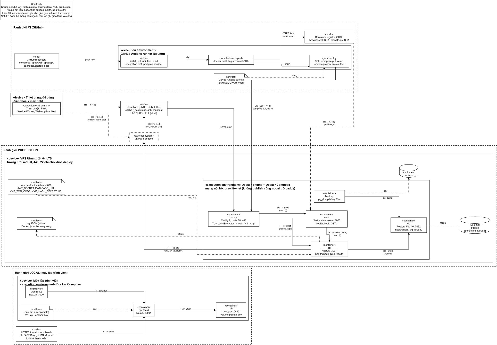

# Task 3.2 – Deployment diagram BrewLite (production)

Tài liệu mô tả UML deployment diagram cho môi trường production của BrewLite, dựa trên kiến trúc Task 3.1 (`architecture.md`, `c4-container`, `component-api`) và các ADR 001 đến 011.

> **Phạm vi tài liệu này:** Mô tả kiến trúc triển khai **đã được chốt** (nền tảng, container, mạng, secret, CI/CD). Mã nguồn thực tế (`apps/`, `deploy/`, `.github/workflows/`) chưa tồn tại — sẽ hiện thực trong Task 4 và Task 5. Các đường dẫn trong Mục 7 là quy ước monorepo (ADR-001) sẽ tuân theo khi code.

- Nguồn Draw.io: `docs/diagrams/sources/deployment-production.drawio`; nguồn Graphviz: `docs/diagrams/sources/deployment-production.dot`; bản xuất: `docs/diagrams/exports/deployment-production.svg`.
- Quy ước: đen trắng; `«device»`, `«execution environment»` là node UML (hộp 3D), `«artifact»` là tệp triển khai (ghi chú gấp góc), `«external»` là hệ thống bên ngoài (nét đứt đậm), hình trụ là volume / persistent storage; khung nét đứt lớn là ranh giới môi trường (local, CI, production); mũi tên nét liền có `«giao thức»` là communication path, mũi tên nét đứt là dependency / association; nhãn ghi giao thức và cổng.

## 1. Nền tảng triển khai được chọn

**Một VPS Ubuntu 24.04 LTS chạy Docker Compose**, Caddy làm reverse proxy HTTPS, Cloudflare làm DNS/CDN, GHCR làm container registry, GitHub Actions làm CI/CD (ADR-011). Lý do chính: giống Docker Compose local, chi phí thấp, mạng nội bộ và persistent storage dễ kiểm soát và dễ kiểm chứng. VNPay Sandbox cần endpoint IPN HTTPS công khai nên cần một tên miền trỏ về hệ thống.

**Đây là quyết định kiến trúc đã chốt.** Tên miền cụ thể, thông số VPS và workflow CI/CD thực tế sẽ được thiết lập trong Task 4 (Task 4.1 – Thiết lập repository, Task 4.4 – CI) và Task 5 (Task 5.3 – CD, Task 5.4 – Triển khai). Các placeholder trong tài liệu này (`<tên-miền>`) phải được thay bằng giá trị thật trước khi bàn giao.

## 2. Các phần tử trên sơ đồ

### 2.1. Production

| Phần tử | Loại UML | Mô tả | Cổng / giao thức |
| :--- | :--- | :--- | :--- |
| Thiết bị người dùng, Trình duyệt/PWA | device, execution environment | Chạy Web App (Next.js PWA/SSR — container `web`); Service Worker và Web App Manifest cho PWA. Không chứa nghiệp vụ (ADR-007). | HTTPS 443 tới Cloudflare |
| Cloudflare | node | DNS, CDN cho `/_next/static`, ảnh, manifest; TLS, chế độ Full (strict) | HTTPS 443 vào và ra |
| VPS Ubuntu 24.04 | device | Máy chủ duy nhất; tường lửa **chỉ mở 80 và 443** ra Internet; cổng 22 chỉ cho khóa deploy SSH; mọi cổng khác đóng | — |
| Docker Engine + Compose | execution environment | Chạy các container trong mạng nội bộ `brewlite-net`; không có container nào khác publish cổng ngoài `proxy` | — |
| `proxy` (Caddy 2) | container | **Container duy nhất publish 80/443 ra ngoài**; TLS Let's Encrypt tự động; `/` → `web:3000`, `/api` → `api:3001` | **80, 443 (public)** |
| `web` (Next.js standalone) | container | Giao diện PWA/SSR — Web App trong C4 Container (ADR-007); không chứa nghiệp vụ; healthcheck `GET /` | **3000 nội bộ** — không expose |
| `api` (NestJS) | container | **Toàn bộ nghiệp vụ** — API Application trong C4 Container (ADR-002): xác thực, phân quyền, tồn kho, thanh toán, IPN, đối soát, health check, logging; healthcheck `GET /health` | **3001 nội bộ** — không expose |
| `db` (PostgreSQL 16) | container | Database trong C4 Container (ADR-003); **không publish cổng**, chỉ `api` truy cập qua mạng Docker nội bộ; healthcheck `pg_isready` | **5432 nội bộ** — không expose |
| `backup` | container | `pg_dump` hằng đêm vào volume `backups` | — |
| `pgdata`, `backups` | volume | Persistent storage cho dữ liệu và bản sao lưu | — |
| `.env.production` | artifact | Secret và biến môi trường, quyền 600, nằm trên VPS, không trong repo | `env_file` |
| Log JSON | artifact | `api`/`web` ghi stdout; Docker `json-file` có xoay vòng (`max-size`, `max-file`) | — |
| GHCR | node | Registry chứa `brewlite-web:<SHA>`, `brewlite-api:<SHA>` | HTTPS 443 |
| VNPay Sandbox | external system | **Nằm ngoài ranh giới BrewLite** (ACT-04, ADR-004); trang thanh toán thử nghiệm; gửi IPN qua HTTPS tới `proxy` → `api`; nhận yêu cầu ký và QueryDR từ `api`; Return URL chuyển trình duyệt về `web` | HTTPS 443 |

### 2.2. CI và Local

| Môi trường | Phần tử | Vai trò |
| :--- | :--- | :--- |
| CI (GitHub) | Repository (monorepo) | Nguồn mã; mọi thay đổi qua PR |
| CI | Job `ci` | install, lint, unit test, build, integration test với PostgreSQL service |
| CI | Job `build-and-push` | Dựng image, gắn tag commit SHA, đẩy lên GHCR (chỉ khi merge vào `main`) |
| CI | Job `deploy` | SSH vào VPS, `compose pull` và `up -d`, chạy migration, smoke test `GET /api/health` |
| CI | GitHub Actions secrets | Khóa SSH deploy, token GHCR; **runner không giữ secret ứng dụng production** (`JWT_SECRET`, `VNP_*`...) — các secret này chỉ nằm trong `.env.production` trên VPS |
| Local | Docker Compose (web, api, db) | Môi trường lập trình; `db` dùng volume `pgdata-dev`; cấu hình từ `.env` (sinh từ `.env.example`) |
| Local | Tunnel HTTPS (cloudflared) | Chỉ dùng khi cần VNPay Sandbox gọi IPN về máy local (RR-07) |

> **Lưu ý:** Workflow CI/CD (`ci.yml`, `deploy.yml`) là kiến trúc đã quyết định nhưng **chưa được tạo trong repository**. Các file này sẽ được hiện thực trong Task 4.4 (CI) và Task 5.3 (CD). Tương tự, `deploy/docker-compose.prod.yml`, `deploy/Caddyfile` chưa tồn tại và sẽ được tạo trong Task 4–5.

## 3. Luồng kết nối và cổng

| Từ → Đến | Giao thức, cổng | Ghi chú |
| :--- | :--- | :--- |
| Trình duyệt → Cloudflare → `proxy` | HTTPS 443 | Điểm vào duy nhất từ Internet |
| `proxy` → `web` | HTTP 3000 | Mạng Docker nội bộ |
| `proxy` → `api` | HTTP 3001, tiền tố `/api` | Cùng tên miền với web, không cần CORS |
| `web` → `api` | HTTP 3001 | Gọi nội bộ khi SSR |
| `api` → `db` | TCP 5432 | Chỉ trong `brewlite-net`; không có đường từ Internet |
| Trình duyệt → VNPay Sandbox | HTTPS 443 | Chuyển hướng thanh toán (Return URL quay về qua cùng đường vào) |
| VNPay Sandbox → `proxy` → `api` | HTTPS 443 | IPN tới `/api/...`, công khai, xác minh chữ ký |
| `api` → VNPay Sandbox | HTTPS 443 | URL thanh toán có chữ ký, QueryDR |
| `ci_dep` → VPS | SSH 22 | Khóa riêng chỉ cho deploy |
| VPS ← GHCR | HTTPS 443 | Kéo image theo tag SHA |

## 4. Secret, biến môi trường, health check và log

- **Biến môi trường (chỉ tên, không có giá trị):** `NODE_ENV`, `PORT`, `DATABASE_URL`, `POSTGRES_USER`, `POSTGRES_PASSWORD`, `POSTGRES_DB`, `JWT_SECRET`, `JWT_EXPIRES_IN`, `VNP_TMN_CODE`, `VNP_HASH_SECRET`, `VNP_URL`, `VNP_RETURN_URL`, `APP_BASE_URL`, `LOG_LEVEL`, `IMAGE_TAG`. Biến `NEXT_PUBLIC_*` của Next.js được nhúng lúc build nên chỉ chứa giá trị không bí mật (ví dụ đường dẫn `/api`).
- **Nơi giữ secret:** `.env.production` trên VPS (quyền 600); khóa SSH và token GHCR trong GitHub Actions secrets. Repository chỉ có `.env.example` và `deploy/.env.production.example` không chứa secret (ADR-010, ADR-011).
- **Health check:** `GET /health` của API (kiểm tra API và database), `pg_isready` cho `db`, `GET /` cho `web`; Compose dùng `healthcheck`, `depends_on: condition: service_healthy` và `restart: unless-stopped`.
- **Log:** JSON ra stdout, có `requestId`, che secret/JWT/mật khẩu; xem bằng `docker compose logs`; Docker xoay vòng log để không đầy đĩa.

## 5. Ranh giới local, CI và production

| Nội dung | Local | CI | Production |
| :--- | :--- | :--- | :--- |
| Nơi chạy | Máy lập trình viên, Docker Compose | GitHub Actions runner tạm thời | VPS, Docker Compose |
| Database | Container `db`, volume `pgdata-dev`, seed mẫu | Postgres service container, bỏ sau mỗi lần chạy | Container `db`, volume `pgdata`, có backup |
| Secret | `.env` cá nhân, khóa VNPay Sandbox của nhóm | Chỉ khóa SSH và token GHCR (không secret ứng dụng) | `.env.production` trên VPS |
| HTTPS | Không bắt buộc (tunnel khi thử IPN) | Không áp dụng | Bắt buộc (Caddy + Cloudflare) |
| Cổng mở ra ngoài | 3000, 3001, 5432 trên localhost | Không | Chỉ 80, 443 (và 22 cho deploy) |
| Image | Build tại máy | Build và đẩy lên GHCR | Chỉ kéo image tag SHA từ GHCR |

## 6. Quy trình triển khai và rollback

1. Lập trình viên mở PR; CI chạy `ci` (install, lint, unit test, build, integration test). Thất bại thì không merge.
2. Merge vào `main`: `build-and-push` tạo image tag SHA đẩy lên GHCR.
3. `deploy`: SSH vào VPS, đặt `IMAGE_TAG`, `compose pull`, chạy migration, `compose up -d`, rồi smoke test `https://<tên-miền>/api/health`.
4. Rollback: đặt `IMAGE_TAG` về SHA trước đó và chạy lại `compose up -d` (migration viết tương thích lùi một phiên bản).

## 7. Truy vết deployment → kiến trúc → mã nguồn

Repository hiện (nhánh `develop`) mới có tài liệu, **chưa có mã nguồn**; cột "Đường dẫn dự kiến" theo cấu trúc monorepo của ADR-001 và sẽ khớp khi nhóm hiện thực.

| Phần tử deployment | Thành phần kiến trúc (Task 3.1) | ADR | Đường dẫn dự kiến |
| :--- | :--- | :-: | :--- |
| Trình duyệt/PWA, `web` | Container Web App | 007 | `apps/web/`, `apps/web/Dockerfile`, `apps/web/public/manifest.webmanifest` |
| `api` | Container API Application (mọi module của component diagram) | 002, 005, 006, 008–010 | `apps/api/`, `apps/api/Dockerfile` |
| healthcheck `api` | `HealthModule` | 010 | `apps/api/src/health/` |
| `db`, volume `pgdata` | Container Database; `DatabaseModule` | 003 | `apps/api/src/database/migrations/`, `apps/api/src/database/seeds/` |
| Biến môi trường, `.env.production` | `ConfigModule` | 010 | `apps/api/src/config/`, `.env.example`, `deploy/.env.production.example` |
| Log JSON | `LoggerModule` | 010 | `apps/api/src/logger/` |
| Kết nối VNPay, IPN | `PaymentsModule`, `VnpayGatewayModule` | 004, 005, 008 | `apps/api/src/payments/`, `apps/api/src/vnpay-gateway/` |
| Job đối soát | `ReconciliationJob` (trong `api`) | 006 | `apps/api/src/payments/reconciliation.job.ts` |
| `proxy` (Caddy) | Điểm vào HTTPS của hệ thống BrewLite | 011 | `deploy/Caddyfile` |
| Compose production, `backup` | Hạ tầng triển khai | 011 | `deploy/docker-compose.prod.yml`, `deploy/backup.sh` |
| Compose local, `.env` | Môi trường local | 001, 011 | `docker-compose.yml`, `.env.example` |
| CI, build-and-push, deploy, GHCR | Quy trình CI/CD | 011 | `.github/workflows/ci.yml`, `.github/workflows/deploy.yml` |
| Gói dùng chung | `packages/shared` | 001 | `packages/shared/` |

## 8. Điểm cần nhóm xác nhận

- **Nền tảng thực tế:** VPS Ubuntu 24.04 LTS + Docker Compose, Caddy reverse proxy, GHCR, GitHub Actions đã được chấp nhận theo ADR-011. Sơ đồ production sử dụng quyết định kiến trúc này.
- **Tên miền và VPS:** cần một tên miền (cho Cloudflare, Let's Encrypt, IPN) và một VPS; các placeholder `<tên-miền>` phải thay bằng giá trị thật. Địa chỉ IPN cũng phải đăng ký với VNPay Sandbox.
- **Cổng, phiên bản image** (Caddy 2, PostgreSQL 16, Node LTS) là giá trị khởi điểm.
- **Đường dẫn mã nguồn** ở mục 7 là dự kiến cho đến khi có code.
- Chưa có cơ chế giám sát ngoài log và health check, và chưa có phương án sao lưu ra ngoài VPS (cần nếu muốn chịu được mất cả máy).

## 9. Đối chiếu tiêu chí Task 3.2

| Yêu cầu tối thiểu | Nơi thể hiện |
| :--- | :--- |
| Thiết bị người dùng chạy trình duyệt/PWA | device + execution environment "Trình duyệt / PWA" |
| Dịch vụ/CDN phục vụ Next.js | Cloudflare (CDN) và container `web` |
| Container chạy NestJS API | container `api` |
| PostgreSQL có persistent storage | container `db` + volume `pgdata` (và `backups`) |
| Container registry và nền tảng triển khai | GHCR; VPS + Docker Compose; GitHub Actions |
| HTTPS, kết nối nội bộ, cổng | Nhãn trên mũi tên; mục 3 |
| Secret/env, health check, log | artifact `.env.production`, healthcheck từng container, log JSON; mục 4 |
| Ranh giới local, CI, production | Ba khung nét đứt; mục 5 |
| Truy vết container/dịch vụ → kiến trúc và mã nguồn | Mục 7 |
